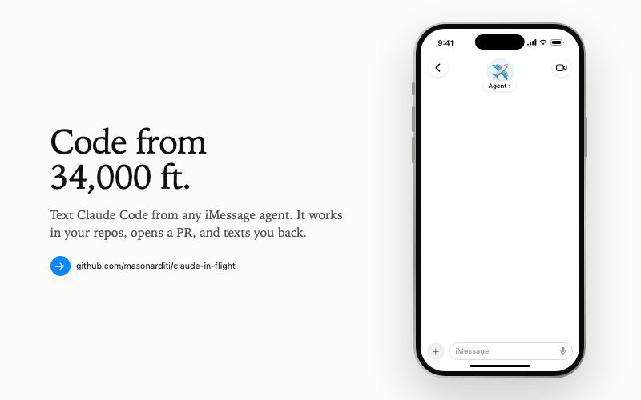

# ✈️ claude-in-flight

**Code from 34,000 ft. For free.** Text tasks to Claude Code over free in-flight messaging. No Wi-Fi to buy.



<sub>made with ❤️ by [@createdbymason](https://x.com/createdbymason) · [watch in HD with sound](docs/demo-phone.mp4)</sub>

Text a task to your iMessage agent (like [Poke](https://poke.com)). A [Claude Code routine](https://code.claude.com/docs/en/routines) does it in the cloud on your Claude plan, opens a PR, and texts you back.

- **Free on many flights.** United, Delta, Alaska and Emirates offer free iMessage on board; JetBlue and Qatar Airways offer free Wi-Fi.
- **Faster than plane Wi-Fi.** The work runs in the cloud; your phone only sends a few texts.

```
you → iMessage agent → relay (this repo, on Vercel) → Claude Code routine
 ▲                                                          │
 └──────────────── summary + PR link ◀──────────────────────┘
```

> Unofficial; not affiliated with Anthropic, Poke, or any airline. Airline policies vary by route.

## You need

Claude **Pro or Max** · GitHub repos with the [Claude GitHub App](https://github.com/apps/claude) · a free **Vercel** account · an iMessage agent that supports **custom MCP servers** (tested with Poke)

## Setup (~5 min)

**Easiest: let Claude Code do it.** Paste this into Claude Code:

```
Set up claude-in-flight for me by following https://raw.githubusercontent.com/masonarditi/claude-in-flight/master/docs/agent-setup.md step by step.
```

It deploys the relay to your Vercel account and walks you through the few clicks only you can do. Or set it up by hand:

**1. Create the Claude task.** At [claude.ai/code/routines](https://claude.ai/code/routines) → **New task**:
- Instructions: paste [`routine-prompt.md`](routine-prompt.md)
- Model: select **Opus** explicitly (not Default)
- Repository: add your repos
- Cloud environment: a new one with **Full** network access
- Trigger: **API**. After creating, open **Edit → API trigger**, copy the **Fire URL**, and **Generate token**.

**2. Deploy the relay.**

[](https://vercel.com/new/clone?repository-url=https%3A%2F%2Fgithub.com%2Fmasonarditi%2Fclaude-in-flight&project-name=claude-in-flight&repository-name=claude-in-flight&env=ROUTINE_URL%2CROUTINE_TOKEN%2CRELAY_KEY%2CNOTIFY_URL%2CNOTIFY_TOKEN&envDefaults=%7B%22NOTIFY_URL%22%3A%22https%3A%2F%2Fpoke.com%2Fapi%2Fv1%2Finbound%2Fapi-message%22%7D&envDescription=Fire%20URL%20and%20token%20from%20your%20Claude%20task%2C%20a%20random%20RELAY_KEY%2C%20and%20where%20to%20push%20results%20%28Poke%20by%20default%3B%20set%20both%20NOTIFY_%2A%20to%20none%20to%20skip%29.&envLink=https%3A%2F%2Fgithub.com%2Fmasonarditi%2Fclaude-in-flight%23setup-5-min&stores=%5B%7B%22type%22%3A%22integration%22%2C%22integrationSlug%22%3A%22upstash%22%2C%22productSlug%22%3A%22upstash-kv%22%2C%22protocol%22%3A%22storage%22%7D%5D)

| Variable | Value |
| --- | --- |
| `ROUTINE_URL` / `ROUTINE_TOKEN` | The task's Fire URL and token |
| `RELAY_KEY` | Any long random string (`openssl rand -hex 24`) |
| `NOTIFY_URL` / `NOTIFY_TOKEN` | Where results are pushed: prefilled for Poke, plus your [Poke API key](https://poke.com/kitchen). `none` to skip |

It also creates a free Upstash Redis store. Then open your deployment URL: it checks your config and shows your exact links.

**3. Let Claude report back.** In the task's cloud environment → **Network secrets → Add secret**: **Bearer**, host `<your-project>.vercel.app`, path `/api/result`, value = `RELAY_KEY`.

**4. Connect your agent.** Add an MCP server: `https://<your-project>.vercel.app/api/mcp`, API key = `RELAY_KEY`. Then text: *"Ask Claude Code to add a hello line to the README in &lt;repo&gt;."*

## Good to know

- **Each text is a fresh session.** Name the repo and give it the context it needs.
- **Results** are pushed to `NOTIFY_URL` as `{"message", "task_id"}`, and kept for 7 days via the `get_task_result` tool.
- **It can't create repos.** Create one and add it to the task first. The cloud browser isn't logged into your accounts.
- **Routines run without approval prompts.** Limit the repos, connectors, and network they can reach.
- **Keys:** `RELAY_KEY` guards the relay in both directions; rotate it (and the routine token) if either leaks.
- Routines are a research preview. Runs count against your plan, capped at 30 API triggers/hour.

## How it works

[`api/mcp.ts`](api/mcp.ts) starts tasks and returns results · [`api/result.ts`](api/result.ts) receives Claude's summary and pushes it · [`api/setup.ts`](api/setup.ts) is the setup page · [`video/`](video) is the demo, made with [Remotion](https://remotion.dev). Airline logos via [Simple Icons](https://simpleicons.org).

[MIT](LICENSE)
